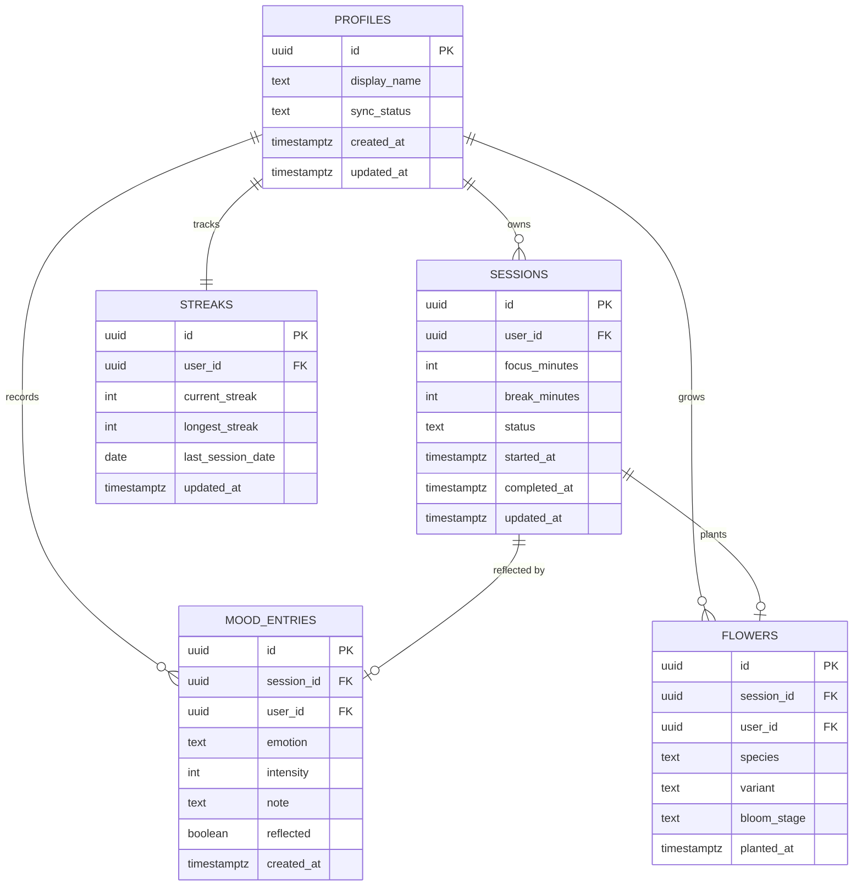

# DATABASE.md: Flowrest

> Legacy blueprint for a planned Supabase and IndexedDB schema. The current MVP stores `Session` records in localStorage only. See `PRD.md` and `src/storage/`.

## Entity-Relationship Diagram



## Table Definitions

### profiles

Mirror of `auth.users` (Supabase Auth). Created via trigger on signup. Guests remain local-only and never appear here (DEC-001).

| Column | Type | Constraints |
|:---|:---|:---|
| id | uuid | PK, FK → auth.users.id, ON DELETE CASCADE |
| display_name | text | NULL |
| sync_status | text | NOT NULL, DEFAULT 'active', CHECK IN ('active','paused') |
| created_at | timestamptz | NOT NULL, DEFAULT now() |
| updated_at | timestamptz | NOT NULL, DEFAULT now() |

Indexes: `profiles_pkey (id)`.

### sessions

One row per completed or aborted focus session (FR-01, FR-02). Durations are user-defined minutes (DEC-004).

| Column | Type | Constraints |
|:---|:---|:---|
| id | uuid | PK, DEFAULT gen_random_uuid() |
| user_id | uuid | NOT NULL, FK → profiles.id, ON DELETE CASCADE |
| focus_minutes | int | NOT NULL, CHECK BETWEEN 1 AND 180 |
| break_minutes | int | NOT NULL, CHECK BETWEEN 0 AND 60 |
| status | text | NOT NULL, CHECK IN ('completed','aborted') |
| started_at | timestamptz | NOT NULL |
| completed_at | timestamptz | NULL |
| updated_at | timestamptz | NOT NULL, DEFAULT now() |

Indexes: `idx_sessions_user_started (user_id, started_at DESC)`; `idx_sessions_user_status (user_id, status)`.

### mood_entries

Detailed reflection per session (FR-04, DEC-003). `reflected=false` marks a skipped form.

| Column | Type | Constraints |
|:---|:---|:---|
| id | uuid | PK, DEFAULT gen_random_uuid() |
| session_id | uuid | NOT NULL, FK → sessions.id, ON DELETE CASCADE |
| user_id | uuid | NOT NULL, FK → profiles.id, ON DELETE CASCADE |
| emotion | text | NOT NULL, CHECK IN ('calm','anxious','happy','tired','focused','sad') |
| intensity | int | NOT NULL, CHECK BETWEEN 1 AND 5 |
| note | text | NULL, CHECK char_length(note) <= 500 |
| reflected | boolean | NOT NULL, DEFAULT true |
| created_at | timestamptz | NOT NULL, DEFAULT now() |

Indexes: `uq_mood_session (session_id)` UNIQUE; `idx_mood_user_emotion (user_id, emotion)`.

### flowers

Garden entity (FR-03, FR-05, FR-06, DEC-002). One base flower per completed session; mood drives appearance; streaks unlock rare `variant`.

| Column | Type | Constraints |
|:---|:---|:---|
| id | uuid | PK, DEFAULT gen_random_uuid() |
| session_id | uuid | NOT NULL, FK → sessions.id, ON DELETE CASCADE |
| user_id | uuid | NOT NULL, FK → profiles.id, ON DELETE CASCADE |
| species | text | NOT NULL, CHECK IN ('daisy','rose','tulip','lotus','orchid') |
| variant | text | NOT NULL, DEFAULT 'common', CHECK IN ('common','rare','epic','legendary') |
| bloom_stage | int | NOT NULL, CHECK BETWEEN 1 AND 5 |
| planted_at | timestamptz | NOT NULL, DEFAULT now() |

Indexes: `uq_flower_session (session_id)` UNIQUE; `idx_flower_user_planted (user_id, planted_at DESC)`.

### streaks

Single-row-per-user streak aggregate (FR-06, FR-09).

| Column | Type | Constraints |
|:---|:---|:---|
| id | uuid | PK, DEFAULT gen_random_uuid() |
| user_id | uuid | NOT NULL, FK → profiles.id, ON DELETE CASCADE |
| current_streak | int | NOT NULL, DEFAULT 0, CHECK >= 0 |
| longest_streak | int | NOT NULL, DEFAULT 0, CHECK >= 0 |
| last_session_date | date | NULL |
| updated_at | timestamptz | NOT NULL, DEFAULT now() |

Indexes: `uq_streak_user (user_id)` UNIQUE.

## Prisma Schema

```prisma
generator client {
  provider = "prisma-client-js"
}

datasource db {
  provider = "postgresql"
  url      = env("DATABASE_URL")
}

model Profile {
  id          String    @id @db.Uuid
  displayName String?   @map("display_name")
  syncStatus  String    @default("active") @map("sync_status")
  createdAt   DateTime  @default(now()) @map("created_at") @db.Timestamptz
  updatedAt   DateTime  @default(now()) @updatedAt @map("updated_at") @db.Timestamptz

  sessions    Session[]
  moods       MoodEntry[]
  flowers     Flower[]
  streak      Streak?

  @@map("profiles")
}

model Session {
  id           String    @id @default(uuid()) @db.Uuid
  userId       String    @map("user_id") @db.Uuid
  focusMinutes Int       @map("focus_minutes")
  breakMinutes Int       @map("break_minutes")
  status       String
  startedAt    DateTime  @map("started_at") @db.Timestamptz
  completedAt  DateTime? @map("completed_at") @db.Timestamptz
  updatedAt    DateTime  @default(now()) @updatedAt @map("updated_at") @db.Timestamptz

  profile Profile    @relation(fields: [userId], references: [id], onDelete: Cascade)
  mood    MoodEntry?
  flower  Flower?

  @@index([userId, startedAt(sort: Desc)])
  @@index([userId, status])
  @@map("sessions")
}

model MoodEntry {
  id        String   @id @default(uuid()) @db.Uuid
  sessionId String   @unique @map("session_id") @db.Uuid
  userId    String   @map("user_id") @db.Uuid
  emotion   String
  intensity Int
  note      String?
  reflected Boolean  @default(true)
  createdAt DateTime @default(now()) @map("created_at") @db.Timestamptz

  session Session @relation(fields: [sessionId], references: [id], onDelete: Cascade)
  profile Profile @relation(fields: [userId], references: [id], onDelete: Cascade)

  @@index([userId, emotion])
  @@map("mood_entries")
}

model Flower {
  id         String   @id @default(uuid()) @db.Uuid
  sessionId  String   @unique @map("session_id") @db.Uuid
  userId     String   @map("user_id") @db.Uuid
  species    String
  variant    String   @default("common")
  bloomStage Int      @map("bloom_stage")
  plantedAt  DateTime @default(now()) @map("planted_at") @db.Timestamptz

  session Session @relation(fields: [sessionId], references: [id], onDelete: Cascade)
  profile Profile @relation(fields: [userId], references: [id], onDelete: Cascade)

  @@index([userId, plantedAt(sort: Desc)])
  @@map("flowers")
}

model Streak {
  id              String   @id @default(uuid()) @db.Uuid
  userId          String   @unique @map("user_id") @db.Uuid
  currentStreak   Int      @default(0) @map("current_streak")
  longestStreak   Int      @default(0) @map("longest_streak")
  lastSessionDate DateTime? @map("last_session_date") @db.Date
  updatedAt       DateTime @default(now()) @updatedAt @map("updated_at") @db.Timestamptz

  profile Profile @relation(fields: [userId], references: [id], onDelete: Cascade)

  @@map("streaks")
}
```

## Notes & Constraints

- **Offline-first (DEC-001):** All five tables are cloud mirrors of local IndexedDB. Records carry client-generated UUIDs so merges are idempotent; sync uses last-write-wins on `updated_at`. Local tombstones are not persisted server-side.
- **Row-Level Security:** Enable RLS on all tables. Policy pattern: `USING (user_id = auth.uid())` for `sessions`, `mood_entries`, `flowers`, `streaks`; `profiles` uses `id = auth.uid()`. Admin reads aggregate views only (FR-13); individual `note` access is prohibited.
- **Streak thresholds (7/30/100)** and variant mapping are provisional and admin-adjustable (FR-14) — store thresholds in a future `app_config` table; values are `TBD` in DEC-002.
- **Partial-index caveat:** No partial unique indexes are required in the current schema. If a future rule (e.g., unique completed session per day) is introduced, Prisma cannot express it — apply via raw SQL migration: `CREATE UNIQUE INDEX uq_session_user_day ON sessions (user_id, (started_at::date)) WHERE status = 'completed';`